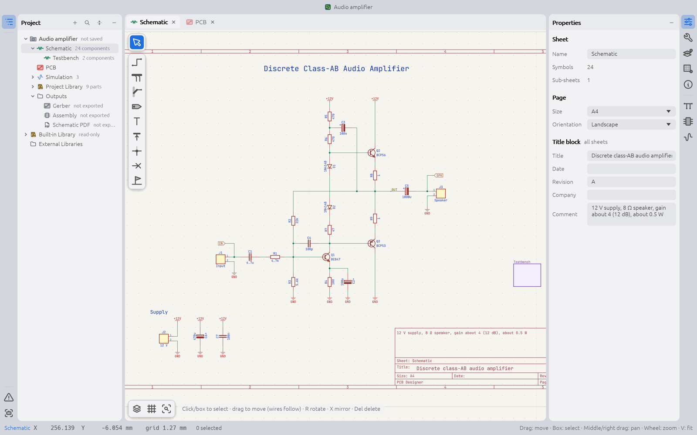
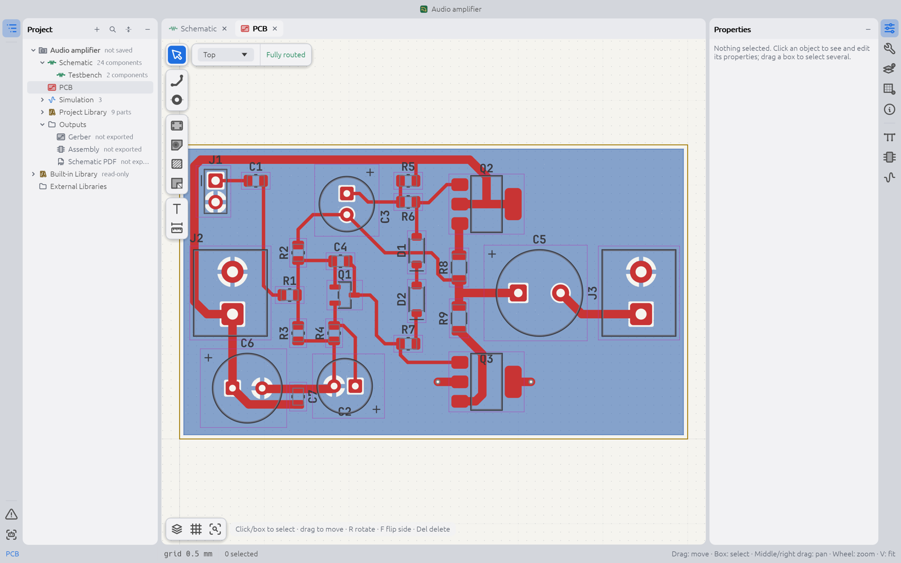
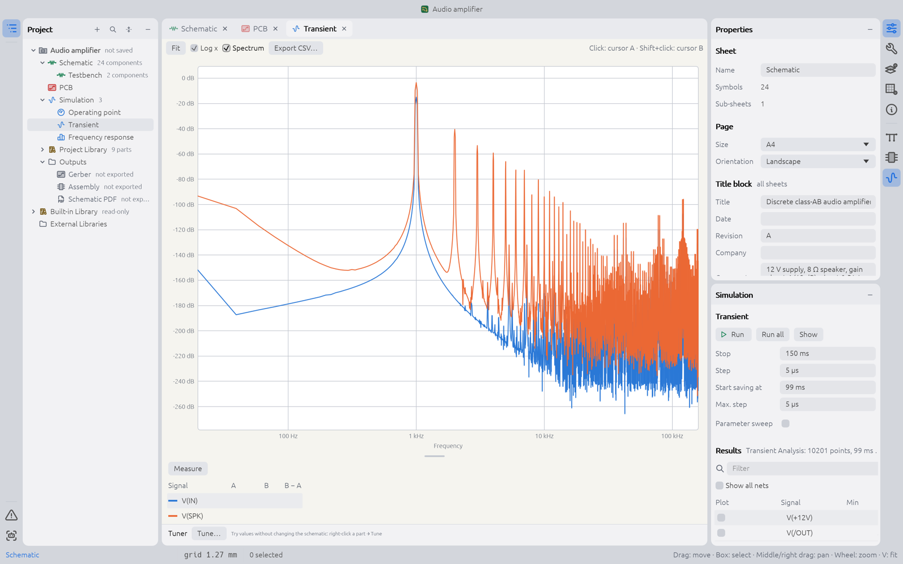

# PCB Designer

A schematic, PCB and part editor written in Rust (egui + wgpu). Schematic changes show up on
the board immediately, projects are folders of JSON files that diff well, and AI agents can
work on the open project through MCP while you watch.

- **Schematic:** hierarchical sheets, buses, labels and power ports as in KiCad, live ERC.
- **PCB:** push-and-shove routing, net classes, blind and buried vias, copper zones,
  keepouts, DRC.
- **Libraries:** a built-in library of generic parts, symbol, footprint and part editors,
  KiCad library and project import.
- **Manufacturing:** Gerber X2, Excellon, job file, BOM and positions (JLCPCB, PCBWay), a
  Gerber viewer, schematic PDF.
- **Simulation:** ngspice with probes on the schematic, plots, measurements, a tuner and
  parameter sweeps.
- **Agents:** an MCP server in the app or headless; every edit an agent makes can be
  undone.







The [audio amplifier example](docs/user-interface.md#example-projects) (`--example amp`):
schematic, board, and the spectrum of a 1 kHz sine through it.

## Documentation

- [User interface and settings](docs/user-interface.md)
- [Schematic](docs/schematic.md)
- [PCB](docs/pcb.md)
- [Editing](docs/editing.md)
- [Design checks (ERC and DRC)](docs/checks.md)
- [Libraries and parts](docs/libraries.md)
- [Manufacturing files](docs/manufacturing.md)
- [Simulation](docs/simulation.md)
- [KiCad import](docs/kicad.md)
- [Agents (MCP)](docs/agents.md)
- [Command line](docs/command-line.md)
- [Development](docs/development.md)

## Install

Download the build for your system from the
[releases](https://github.com/fabmax/pcb-designer/releases): macOS (Apple Silicon),
Linux and Windows (x86_64).

- **macOS:** unzip and move `PCB Designer.app` to Applications. The app is only ad-hoc
  signed (not notarized), so macOS refuses to open it at first: open it once, then click
  **Open Anyway** in **System Settings → Privacy & Security** and confirm. (Right-click →
  Open no longer does this since macOS 15.) Or clear the download's quarantine flag with
  `xattr -dr com.apple.quarantine "PCB Designer.app"`.
- **Linux:** unpack `pcb-designer` from the archive and run it.
- **Windows:** unzip and run `pcb-designer.exe`.

For simulation, install [ngspice](https://ngspice.sourceforge.io/) as well
(`brew install ngspice libngspice`, `apt install ngspice libngspice0`, or the Windows
download); see [Simulation](docs/simulation.md#installing-ngspice).

## Build from source

With a current stable [Rust](https://rustup.rs):

```sh
cargo run --release -p app                 # an empty project
cargo run --release -p app -- my.pcbproj   # open a project folder
cargo run --release -p app -- --demo       # the demo project
cargo run --release -p app -- --example amp  # a discrete audio amplifier
cargo test --workspace
```

On Linux, install the window system's development packages first; on macOS,
`scripts/bundle-macos.sh` builds the app bundle. See [Development](docs/development.md).

## License

PCB Designer is licensed under the [MIT License](LICENSE). Bundled third-party assets keep
their own licenses: [JetBrains Mono](https://www.jetbrains.com/lp/mono/) under the SIL Open
Font License 1.1 (`crates/render/fonts/OFL.txt`), [Tabler icons](https://tabler.io/icons)
under MIT (`crates/app/icons/tabler/LICENSE`). KiCad's libraries, which the app can
download, are CC-BY-SA 4.0 with an exception for designs made with them.
