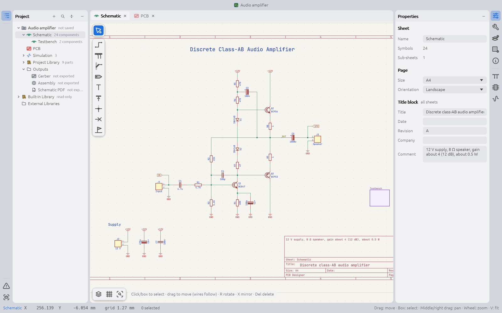

# PCB Designer documentation

PCB Designer is a schematic, PCB and part editor: schematic changes show up on the board
immediately, projects are folders of JSON files, and AI agents can work on the open
project through MCP. Download it from the
[releases](https://github.com/fabmax/pcb-designer/releases) (macOS, Linux, Windows), or
[try it in the browser](https://fabmax.github.io/pcb-designer/app/) (experimental, see
[the browser version](web.md)).

- [User interface and settings](user-interface.md): tabs, panels, settings, recovery
- [Schematic](schematic.md): sheets, labels, power ports, moving objects between sheets
- [PCB](pcb.md): routing (push and shove), net classes, vias, zones and keepouts
- [Editing](editing.md): drawing, selecting and dragging, copy and paste, texts, measuring
- [Design checks](checks.md): ERC and DRC, severities, exclusions
- [Libraries and parts](libraries.md): the Project panel, Project and Built-in Libraries,
  the Parts panel, part editors
- [Manufacturing files](manufacturing.md): Gerber, drill, BOM, positions, schematic PDF
- [Simulation](simulation.md): ngspice, analyses, probes, plots, tuner, sweeps, models
- [KiCad](kicad.md): importing KiCad libraries and projects, exporting to KiCad
- [Agents (MCP)](agents.md): letting an AI agent use the app, in a window or headless
- [Command line](command-line.md): options and commands without a window
- [The browser version](web.md): what works there, projects in the browser's storage,
  uploading and downloading files
- [Development](development.md): building, testing, releases
